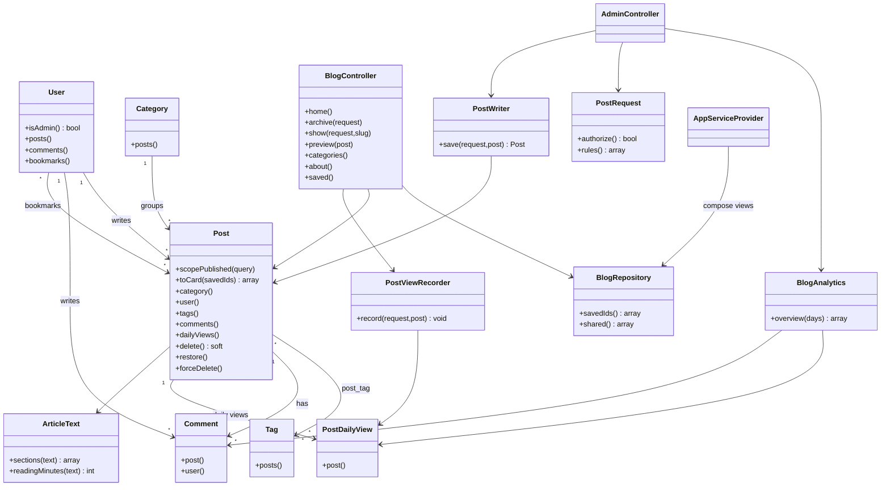

# Kiến trúc và sơ đồ lớp

## MVC trong Laravel

```text
HTTP → routes/web.php → CSRF + session + khóa tài khoản
  ├─ public → BlogController → BlogRepository / Post::published
  ├─ auth   → AuthController → Laravel Auth / Password broker
  ├─ reader → ReaderController / AccountController → Eloquent
  └─ admin  → EnsureAdmin → AdminController / TaxonomyController
                           └─ PostRequest → PostWriter → transaction + upload
                                ↓
                      Eloquent Models → MySQL
                                ↓
                  Blade layouts / components / pages
```

Blade escape dữ liệu mặc định. JavaScript không thay thế backend: không fake CRUD, không lưu bài/bình luận trong localStorage. Form POST/PATCH/DELETE có CSRF và hoạt động không cần JS.

## Sơ đồ lớp rút gọn



Sơ đồ mô tả đúng mã hiện tại, chưa thay thế mẫu sơ đồ yêu cầu riêng của giảng viên. Controller Auth/Account/Reader/Taxonomy/Media đảm nhiệm các chức năng cùng tên; middleware EnsureActiveAccount và EnsureAdmin tách chặn tài khoản/quyền khỏi controller.

## Luồng đăng bài

1. Admin mở editor, server đọc chuyên mục hoạt động và thẻ từ MySQL.
2. Form gửi title/slug/content/category/tags/status/ảnh với CSRF.
3. PostRequest kiểm tra quyền, dữ liệu và MIME/dung lượng ảnh.
4. PostWriter lưu file tên ngẫu nhiên; trong transaction lưu bài và sync bảng nối thẻ.
5. Thành công: dọn ảnh cũ nếu thay/xóa; thất bại: dọn ảnh mới để hạn chế file mồ côi.
6. Redirect về editor với flash; bài published xuất hiện ở blog, draft/archived bị loại bởi scopePublished.

Ảnh upload mới không ghi trực tiếp dưới public/. MediaController kiểm tra whitelist, tồn tại và quyền đọc cover theo trạng thái bài.

## Luồng bình luận / đọc sau

- Guest đọc công khai nhưng cần đăng nhập để lưu/bình luận.
- Server lấy user_id từ session, không nhận quyền/người gửi/trạng thái từ form độc giả.
- Bình luận reader mặc định pending. Trang đọc chỉ query approved hoặc chính user hiện tại.
- Admin review thay trạng thái; approved công khai. Xóa comment chỉ người viết hoặc admin.
- Bookmarks dùng PK ghép và syncWithoutDetaching để POST lặp không tạo trùng.
- Bài ngừng công khai/xóa mềm giữ bookmark nhưng không hiển thị nội dung; chỉ xóa vĩnh viễn mới cascade bookmark. Bình luận của bài thùng rác không được sửa/duyệt đến khi khôi phục.

## Thùng rác và báo cáo theo ngày

AdminController.destroy dùng transaction + khóa hàng để xóa mềm qua Post::SoftDeletes. Trash chỉ query onlyTrashed, có tìm kiếm/phân trang. Restore giữ quan hệ/file và đưa bài về draft; forceDestroy bắt buộc onlyTrashed + confirm_delete được chấp nhận, khóa hàng, cascade DB và dọn ảnh upload sau commit. Slug và FK category tính cả bài đã xóa mềm; seeder không tạo lại hay khôi phục bài mẫu đang ở thùng rác.

BlogController.show gọi PostViewRecorder sau khi xác nhận bài công khai. Recorder bỏ admin, dùng session-key theo post/ngày, insertOrIgnore và tăng hai bộ đếm nguyên tử trong transaction. BlogAnalytics cộng daily views cho 7/30/90 ngày, bù số 0, tạo tọa độ SVG và top 5 bài trong kỳ, kèm hàng chờ bình luận ngoài thùng rác. Blade render biểu đồ và bảng số liệu không cần thư viện chart/JavaScript. Lượt xem tích lũy cũ không bị phân bổ ngược vào lịch sử ngày.

## Xác thực và an toàn

Laravel session auth, session regenerate sau login/register, invalidate khi logout; mật khẩu hashed, broker reset-token dùng một lần. Rate-limit login, register, reset và comment. auth.session chặn phiên cũ khi password hash thay đổi; middleware chặn user bị khóa ở request tiếp theo.

Admin routes có auth + auth.session + admin. Validation loại input sai/array độc hại; old-input không scalar được lọc trước render. SQL qua Eloquent bindings; nội dung user qua Blade escape. Website liên hệ chỉ http/https; không render HTML tùy ý; SVG/PHP upload bị từ chối.

Không có public API hoặc tích hợp Threads/Meta. Repo giữ tên Threads City nhưng nghiệp vụ là blog cá nhân.
