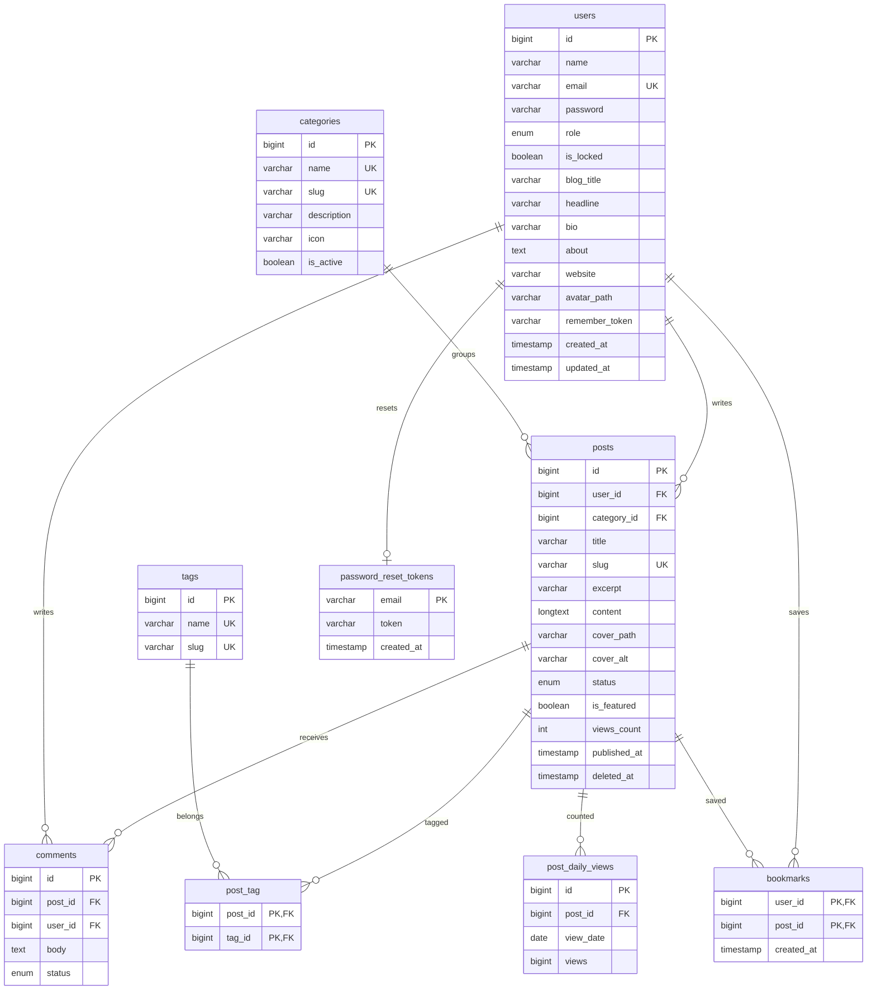

# Thiết kế database MySQL

## Nguồn chuẩn và phạm vi

Các migration trong `database/migrations/` là nguồn chuẩn: `000001` tạo blog, `000002` thêm thùng rác và lượt xem theo ngày. Database ứng dụng: **threads_city_blog**, MySQL 8, InnoDB, utf8mb4. Bản SQL portable nằm trong `database/sql/threads_city_blog.sql`.

Database kiểm thử: **threads_city_blog_test**. Không trỏ test vào database ứng dụng; RefreshDatabase sẽ dựng lại schema test. Không chạy migration hoặc import SQL mới vào database cũ khi chưa backup/đối chiếu.

Có **9 bảng ứng dụng/xác thực** và bảng **migrations** của Laravel, tổng 10 bảng. Session/cache dùng file nên không có bảng sessions/cache.

## ERD

Liên kết email với password_reset_tokens là **logic xác thực**, không có FK vật lý (đúng password broker Laravel). Các model chính có created_at/updated_at; sơ đồ rút gọn không lặp hai cột ở mọi bảng.

## Ràng buộc và nghiệp vụ

| Dữ liệu                    | Quy tắc                                                                                            |
| -------------------------- | -------------------------------------------------------------------------------------------------- |
| users.role                 | admin hoặc reader; đăng ký luôn tạo reader                                                         |
| users.email                | Duy nhất, chuẩn hóa chữ thường                                                                     |
| posts.status               | draft / published / archived                                                                       |
| Bài công khai              | deleted_at=null, status=published, published_at không null và <= hiện tại, category đang hoạt động |
| posts.slug                 | Duy nhất; tự chuyển tiêu đề sang không dấu, thêm hậu tố khi trùng                                  |
| categories.slug, tags.slug | Duy nhất; chữ thường/số/gạch nối                                                                   |
| comments.status            | pending / approved / rejected; độc giả không tự duyệt                                              |
| bookmarks PK               | (user_id, post_id), không lưu trùng                                                                |
| post_tag PK                | (post_id, tag_id), quan hệ N–N                                                                     |
| Xóa mềm post               | Điền deleted_at; giữ các quan hệ và file ảnh, không phục vụ công khai                              |
| Khôi phục post             | deleted_at=null, status=draft, published_at=null; giữ slug và lịch sử                              |
| Xóa vĩnh viễn post         | Chỉ cho bài đã xóa mềm; cascade comments, bookmarks, post_tag, post_daily_views; dọn ảnh upload    |
| Xóa category               | Restrict khi còn post, kể cả bài trong thùng rác; cần chuyển/khôi phục bài trước                   |
| post_daily_views           | Unique (post_id, view_date), views unsigned; tăng nguyên tử trong transaction                      |
| Xóa tag                    | Cascade post_tag; giữ nguyên bài viết                                                              |
| Xóa user                   | Không có chức năng xóa user; FK post restrict bảo vệ tác giả, quản trị chỉ khóa độc giả            |
| Password                   | Hash qua Laravel cast; không lưu mật khẩu rõ                                                       |
| Reset token                | Broker lưu hash token; TTL 60 phút; xóa sau khi dùng                                               |

Index status/published_at/deleted_at cho post, post_id/status cho comment, view_date cho thống kê; FK và unique bổ sung index tra cứu. posts.slug unique gồm cả bài trong thùng rác. Không lưu số lượt like/follow giả.

## Thống kê theo ngày

PostViewRecorder ghi một lượt/bài/phiên/ngày theo Asia/Ho_Chi_Minh, không tính admin và preview. Unique (post_id, view_date) và SQL increment tránh mất cập nhật giữa các phiên đọc. Cả số ngày và posts.views_count tăng trong cùng transaction; bảng không lưu IP/user_id.

BlogAnalytics cộng theo 7/30/90 ngày gồm hôm nay, bù ngày trống bằng 0 và xếp top bài theo lượt **trong kỳ**, không dùng lượt cũ để xếp. SoftDeletes loại bài thùng rác khỏi báo cáo/hàng chờ bình luận; khôi phục làm lịch sử xuất hiện lại. Không phân bổ ngược views_count cũ vào ngày giả.

Migration bổ sung không sửa dữ liệu cũ. Rollback bị chặn nếu còn bài trong thùng rác để tránh vô tình công khai lại; rollback bảng daily views vẫn làm mất lịch sử ngày nên cần backup trước.

## Ảnh và dữ liệu

**Ảnh không lưu binary trong MySQL.** Database chỉ chứa đường dẫn. File nằm ở storage/app/public/covers hoặc avatars, được phục vụ qua MediaController với whitelist filename và MIME upload.

Ảnh bìa upload của nháp/lưu trữ/thùng rác/chuyên mục ẩn chỉ admin xem được, đáp ứng kiểm tra truy cập; response no-store để việc bỏ xuất bản không bị vượt qua bằng cache. Ảnh demo có sẵn trong public/images là tài nguyên công khai và không bị xóa khi xóa vĩnh viễn bài mẫu.

Không tạo public/storage symlink. Backup phải gồm cả MySQL và storage/app/public. SQL dump không bao gồm file upload.

## Đối chiếu SQL cũ

File gốc `../sql/database_test.sql` được giữ nguyên, SHA-256:
`B06906F881BA2529B38EBEF4EA5432D4F3514AC520B4D6450423F818BE21EB62`.

| SQL cũ                                          | Bản Laravel blog cá nhân                                        |
| ----------------------------------------------- | --------------------------------------------------------------- |
| roles / role_id                                 | users.role enum hai quyền, ít tầng phù hợp một chủ blog         |
| user_id/post_id/... là khóa chính tùy biến      | Khóa chính id theo Eloquent, FK user_id/post_id/...             |
| users, categories, tags, posts                  | Giữ ý nghĩa, thay tên/cột theo migration mới                    |
| post_tags                                       | post_tag theo quy ước Eloquent                                  |
| post_media                                      | cover_path/cover_alt ở posts; scope một ảnh bìa                 |
| comments                                        | Không nested thread; bình luận dưới bài với trạng thái duyệt    |
| bookmarks                                       | Giữ chức năng đọc sau, PK ghép                                  |
| user_sessions                                   | Laravel file session                                            |
| password_reset_tokens                           | Schema password broker Laravel                                  |
| follows, post_likes, post_shares, comment_likes | Không triển khai vì trái hướng blog cá nhân                     |
| notifications                                   | Không cần cho scope; flash sau thao tác, email reset            |
| admin_audit_logs                                | Chưa có màn hình/audit trail nghiệp vụ, không giả vờ có dữ liệu |
| DROP DATABASE personal_blog                     | Không dùng; tạo database mới threads_city_blog riêng            |

**Đây không phải migration dữ liệu tự động từ SQL cũ.** Chưa chuyển nội dung/tài khoản thật cũ vì chưa có bản schema lớp/DB chốt từ nhóm. Khi có, cần map từng cột và thiết kế script chuyển dữ liệu có backup, không sửa database đang dùng trực tiếp.

## Import / export / backup

Ưu tiên `php artisan migrate --seed` trên database mới. SQL export là lựa chọn thay thế vào database trống, không chứa DROP DATABASE hay DROP TABLE, có bảng migrations nên Laravel biết migration nào đã áp dụng.

Backup dùng mysqldump hoặc phpMyAdmin; lưu bản backup ở nơi riêng, không commit dữ liệu người dùng/mật khẩu production lên Git. Khôi phục thử ở database phụ trước khi dùng cho production.
