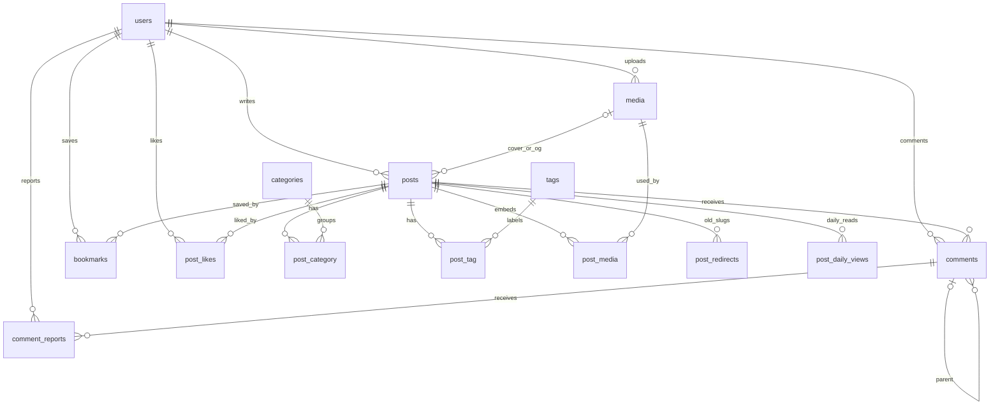

# Database của blog cá nhân

Database chạy trên MySQL 8.4.3 của Laragon, cổng 3307, charset utf8mb4. Database website: moc_blog; database test: moc_blog_test.

Nguồn schema chính xác: database/migrations, gồm schema blog ban đầu, ba migration Laravel mặc định và hai migration cập nhật 13/10/2026 cho post_likes / mặc định bình luận hiển thị ngay. Không có bảng đăng bài của độc giả, follow, tin nhắn hay nhóm mạng xã hội.

## Quan hệ chính

| Bảng | Vai trò | Quan hệ |
| --- | --- | --- |
| users | Tác giả/admin và độc giả | 1–n posts, comments, media; n–n posts qua bookmarks/post_likes |
| posts | Bài viết HTML, trạng thái, SEO, xóa mềm | Thuộc tác giả; n–n categories/tags/media; 1–n comments/views/redirects |
| categories | Danh mục | n–n posts qua post_category |
| tags | Thẻ | n–n posts qua post_tag |
| media | Metadata ảnh, đường dẫn file, ALT | Thuộc người upload; dùng làm cover, OG hoặc ảnh trong nội dung |
| comments | Bình luận và phản hồi | Thuộc bài và độc giả; parent_id liên kết lại comments |
| comment_reports | Báo cáo bình luận | Thuộc comment và user; một user báo cáo một comment tối đa một bản ghi |
| bookmarks | Bài độc giả đã lưu | Khóa chính kép post_id / user_id |
| post_likes | Lượt thích bài của độc giả | Khóa chính kép post_id / user_id; created_at; FK cascade khi xóa post/user |
| post_redirects | Slug cũ | Thuộc post; slug cũ unique |
| post_daily_views | Lượt đọc theo ngày | Thuộc post; unique post_id / view_date |
| settings | Cài đặt blog | Khóa chính key, giá trị text |

## ERD rút gọn

## Trạng thái và toàn vẹn dữ liệu

- Post: draft / published / scheduled. Chỉ public khi published hoặc scheduled và published_at đã tới; bài trong thùng rác không public.
- Xóa mềm bằng deleted_at; vẫn giữ danh mục, bình luận và slug để khôi phục. Trang quản trị phải kiểm tra thao tác xóa vĩnh viễn riêng.
- Xóa vĩnh viễn post sẽ cascade pivot, bookmark, like, comment/report, redirect và lượt đọc. Xóa mềm giữ like để khôi phục. Không tự xóa file media dùng lại hoặc tài khoản.
- Danh mục/thẻ/media đang được pivot tham chiếu và tác giả đang có bài được bảo vệ bằng khóa ngoại restrict.
- Cover/OG bị xóa trực tiếp ở DB sẽ null liên kết; luồng quản trị phải chặn xóa ảnh còn được sử dụng trước khi thao tác file.
- Comment: mặc định **approved (đang hiển thị)**. Bình luận/reply mới hiển thị ngay theo yêu cầu cập nhật; giữ pending cho dữ liệu cũ, hidden/spam để quản trị xử lý vi phạm. Migration không tự công khai pending cũ; độc giả sửa không đổi trạng thái đã bị ẩn. Reply phải cùng bài, cha và tổ tiên đang công khai, tối đa 2 cấp; khóa ngoại không tự kiểm tra các quy tắc này.
- Like: một user một lượt/post; chỉ tài khoản đã xác minh và bài đang public. POST lặp không tạo trùng, DELETE chỉ bỏ lượt của chính user; transaction khóa post khi ghi.
- Reader là role mặc định. Role, google_id và trạng thái xác minh email không được mass assign từ form đăng ký.
- lock_version ngăn tab editor cũ ghi đè nội dung mới; các bước lưu post / pivot / redirect nằm trong một transaction.
- HTML được sanitize trước khi lưu; MySQL giữ rich text và Unicode/emoji đầy đủ.
- Lượt xem được ghi một lần mỗi session/bài/ngày; tác giả/admin không tính vào thống kê. Đây không phải phép đếm người dùng duy nhất hay hệ thống chống bot hoàn chỉnh.

## An toàn khi kiểm thử

tests/TestCase.php kiểm tra kết nối MySQL và database moc_blog_test trước khi RefreshDatabase chạy. Không cho phép dùng moc_blog.

Bộ kiểm thử có thể tạo/xóa schema trong moc_blog_test. Database này không được dùng để lưu dữ liệu thật. Không chạy migrate:fresh/migrate:reset trên database website.

## Sao lưu khi triển khai

Sao lưu cả database MySQL và thư mục storage/app/private chứa media/avatar. Database không chứa dữ liệu nhị phân của ảnh. Dùng Database/HeidiSQL trong Laragon để xuất SQL; không commit bản sao lưu có dữ liệu người dùng hoặc credentials lên Git.

Đã dump/restore DB vào moc_blog_restore_20261013_2246 và kiểm tra 23 bảng khớp số dòng/CHECKSUM EXTENDED. Main DB không bị ghi đè. Chi tiết đường dẫn/hash và giới hạn kiểm thử ảnh rỗng tại README.md.
